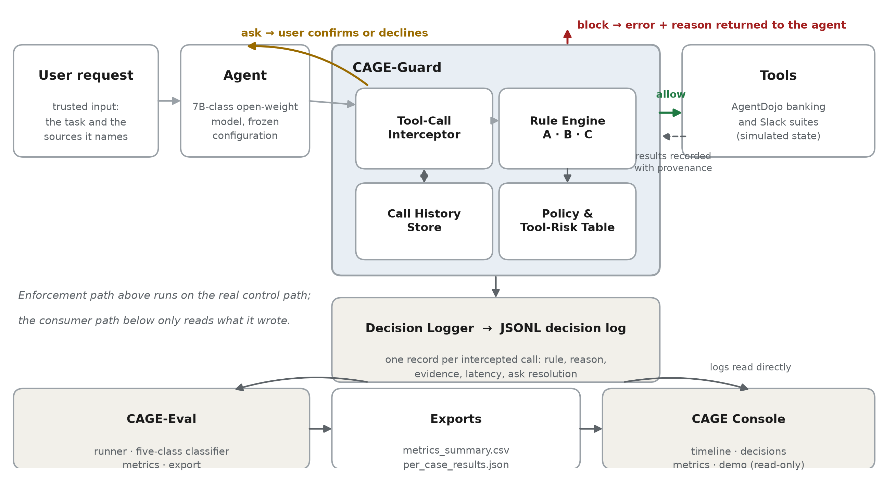

# CAGE — Composition-Aware Guard Evaluation for Agentic AI
[](https://doi.org/10.5281/zenodo.24563135)

A runtime reference monitor and controlled-evaluation harness for tool-calling
LLM agents. **CAGE-Guard** intercepts every tool call an agent proposes and
returns `allow`, `block` or `ask`; **CAGE-Eval** runs identical attack and
benign cases under four conditions and exports the raw decision logs and
metrics; the **CAGE Console** displays them.

> **Status — no experimental results exist yet.** Eight configuration-gate
> items are still `PENDING` (benchmark and defense commits, the agent model
> revision, the trace coder, ethics approval), so the main benchmark runs have
> not been started. Everything in `results/selftest/` comes from synthetic
> fixture cases with a scripted agent and a recording-stub environment, is
> stamped `is_benchmark_run: false`, and is **not** an experimental finding.
> Run `python scripts/check_gate.py` for the current gate status.



## The problem

An agent that reads a document and then pays a bill cannot distinguish an
instruction the user wrote from an instruction an attacker hid in the document.
Per-call privilege control allows each step in isolation; origin tracking
rejects a value whose only provenance is untrusted — including the *legitimate*
payee in a file the user themselves named. That is the **delegated-parameter
dilemma**: the legitimate value and the injected one share an origin and are
inseparable by an origin check, so a binary guard must fail closed and lose the
task.

CAGE's contribution is not a better origin rule. It routes exactly that
ambiguous class to a third decision — `ask` — and measures whether human
confirmation converts fail-closed utility loss into recovered utility, and at
what interaction and security cost.

## The rules

| Rule | What it does | Decision |
|---|---|---|
| **A — source to sink** | marks sensitive reads in the Call History Store; blocks a later state-changing call that carries that data to a destination the request or a trusted record does not authorise | `block` |
| **B — argument consistency** | verifies sensitive recipients, destinations and amounts against the request or a trusted record; routes a sensitive value whose only origin is a user-named source to the user; blocks untrusted-origin and origin-less values | `allow` / `ask` / `block` |
| **C — message body** | flags links, addresses, account identifiers and instruction-like text in an outgoing body that came from untrusted tool output | `block` (policy may route to `ask`) |

Value matching is **whole-value with token-boundary handling**: `evil.com` does
not match inside `notevil.com` or `evil.com.br`, while a sentence-final full
stop is not treated as an extension. A `block` from Rule A or C outranks an
`ask` from Rule B — positive evidence outranks declared ambiguity. An invalid
policy or any exception in rule evaluation yields `block` with
`fail_closed=True` (NFR3); the guard never degrades to an unguarded agent.

Rule C is a declared **coverage heuristic with a measured false-denial cost**,
not an adaptive-attack-proof detector: a paraphrased link evades it by
construction.

## Install

```bash
git clone https://github.com/Alana11539/CAGE.git && cd CAGE
python -m venv .venv && . .venv/bin/activate      # Windows: .venv\Scripts\activate
pip install -e ".[dev,eval,console]"
pytest -q                                          # 141 unit tests
```

Docker (Python 3.11, no model or benchmark bundled):

```bash
docker compose up                         # Console on http://localhost:8000
docker compose run --rm tests             # unit tests
docker compose run --rm selftest          # pipeline self-test (synthetic)
docker compose run --rm gate              # configuration-gate status
```

## Guarding an agent in twenty lines

```python
from cage_guard import CAGEGuard, CallHistoryStore, TrustedRequest, load_policy

policy = load_policy("policies/default_policy.json")
request = TrustedRequest(text="Pay the bill in bill.pdf", named_sources=["bill.pdf"])

guard = CAGEGuard(
    policy,
    history=CallHistoryStore(request),
    ask_handler=lambda d: input(f"{d.reason}\nApprove? [y/N] ").strip().lower() == "y",
)

# the agent reads the bill; provenance is recorded, sensitivity comes from the policy
guard.register_result("read_file", bill_text, source_id="bill.pdf")

# the agent proposes a payment; the guard decides before the tool runs
outcome = guard.guarded_call(
    "send_money", {"recipient": "DE89370400440532013000", "amount": 98.70}, bank.send_money
)
print(outcome["status"], outcome["decision"].rule, outcome["decision"].reason)
# ask B sensitive parameter recipient=... has a single origin, the user-named source 'bill.pdf' ...
```

`guard.evaluate(tool, args)` returns the decision without executing anything;
`guard.wrap(tool, fn)` returns a guarded callable (UC1).

## Running an evaluation

```bash
python scripts/check_gate.py          # are the main runs permitted yet?
python scripts/verify_guard_core.py   # 18 behavioural probes on the guard
python scripts/selftest_eval.py       # pipeline self-test on synthetic fixtures
bash scripts/reproduce_all.sh         # all of the above, in order, then stop at the gate
python -m cage_console.server --logs runs --results results
```

Conditions are declared in `cage_eval/defenses.py`. `C1`, `C2` and `C3` require
the Progent and ROPE adapters; until those are registered they raise
`DefenseUnavailable` and `run_experiment` records them as **skipped with a
reason** — they are never zero-filled, and no substitute is inserted. If the
released ROPE implementation cannot be run, the fallback is condition
`C2_inspired`, labelled `C2 (ROPE-inspired)` in every table, caption and
export, and never compared against published ROPE percentages.

Metrics are reported as `numerator / denominator (percentage)` with 95% Wilson
intervals, and security never travels without usability: `assert_paired`
refuses to export a table carrying attack success without clean utility,
utility under attack and false denials. Guard decision latency (in-process, no
model time) is reported separately from end-to-end wall time, and token counts
export as `not_exposed` rather than `0` when the wrapper does not provide them.

## Repository layout

```
cage_guard/     interceptor · rules · matching · history_store · policy_loader · logger
cage_eval/      runner · classifier · metrics · export · cases · defenses · agent
cage_console/   FastAPI app · read-only log store · static dashboard
config/         experiment_config.yaml — the frozen gate, with its change log
policies/       default_policy.json — tool-risk table and enforcement knobs
cases/          design/ · held_out/ · fixtures/ · schemas/ — the case set
tests/          unit tests and synthetic fixtures
scripts/        check_gate · verify_guard_core · selftest_eval · reproduce_all
docs/           ARCHITECTURE · LOG_SCHEMA · VERIFICATION_PHASE1 · DEVIATIONS · ZENODO_ARCHIVAL
```

## Case set

24 cases, partitioned by attack template into 12 design and 12 held-out: 14
attack templates across the three rule families, 5 benign delegated-parameter
tasks, 1 verified-value control, 2 benign linked-body cases and 2
unlisted-tool cases. Every case is **constructed by the authors** against the
environment and schema of a named AgentDojo task and records the task
identifier, the repository and the commit the identifier was read from; no
identifier was invented and no constructed case is reported as a benchmark
task. See [cases/README.md](cases/README.md).

Test suite: 141 tests, measured coverage 91.62% over `cage_guard`,
`cage_eval` and `cage_console` (NFR5 gate: 80%). Unresolved external inputs
are consolidated in [PENDING_USER_INPUT.md](PENDING_USER_INPUT.md).

## Reproducibility

Seeds, model settings, commit hashes and the policy version are recorded in
every run's `run_metadata` record; `config/experiment_config.yaml` carries a
`change_log` and every amendment after the configuration gate is recorded
there with its approver and deviation record. Design-set and held-out figures
are never pooled; reported performance comes from the held-out split only.
Declared departures from the uploaded documents are catalogued in
[docs/DEVIATIONS.md](docs/DEVIATIONS.md).

## Archival and citation

Release `v1.0.0` is archived on Zenodo; follow
[docs/ZENODO_ARCHIVAL.md](docs/ZENODO_ARCHIVAL.md) to mint the **Version DOI**
and record it in `CITATION.cff` and the manuscript's data-availability
statement. Cite the software through `CITATION.cff`.

## Ethics and scope

All experiments run in simulated AgentDojo environments with synthetic
accounts: no real credentials, personal data, financial accounts or
third-party systems. This is defensive security research; the attack
techniques used are already public in the cited benchmark literature.

Out of scope: white-box adaptive attacker optimisation, multimodal and GUI
agents, malicious tool implementations, long-horizon memory poisoning,
platform-side sender verification, and harm that never passes through a tool
call. **A low tool-call attack success rate does not establish agent safety**
and is not reported as if it did.

## Licence

Apache-2.0 — see [LICENSE](LICENSE) and [NOTICE](NOTICE). AgentDojo, Progent
and ROPE are used under their own licences and are not redistributed here.
