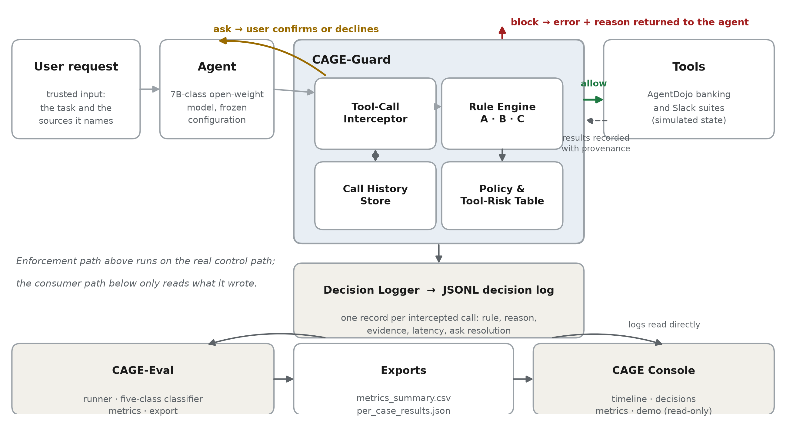

# Architecture

Two paths. The **enforcement path** (agent → guard → tools) runs on the real
control path and decides. The **consumer path** (logs → CAGE-Eval → exports →
Console) only reads what the enforcement path wrote. Nothing in the consumer
path can change a decision, and no reported result depends on the Console.

## CAGE-Guard

| Module | Responsibility |
|---|---|
| `interceptor.py` | `CAGEGuard`: intercepts a proposed call, times the decision, enforces it, handles ask resolution, applies the retry budget, fails closed |
| `rules.py` | Rules A, B, C as pure functions of a `RuleContext`; `evaluate_rules` composes them (block outranks ask) |
| `matching.py` | whole-value matching with token boundaries, amount parsing, artifact extraction, instruction-like patterns |
| `history_store.py` | `TrustedRequest` (trust boundaries) and `CallHistoryStore` (reads and calls of one run) |
| `policy_loader.py` | strict policy / tool-risk-table validation; `PolicyError` on anything malformed |
| `logger.py` | JSONL decision log: one record per intercepted call, plus ask resolutions and run metadata |
| `decisions.py` | `Decision`, `TrustLevel`, `RiskClass`, `GuardDecision` |

**Trust boundaries** (following ROPE): *trusted* — the user request and
platform identity; *declared-trusted* — a record or source the request names;
*untrusted* — everything else the agent reads. Naming a source does not make
its content trusted; it makes a single-origin sensitive value from that source
an `ask` instead of a `block`.

**Adding a rule** (UC7, NFR5): write a function
`rule_x(ctx: RuleContext) -> GuardDecision | None` in `rules.py`, register it in
the `RULES` tuple, add its parameters to the tool-risk table, and add a test
module. No change to the interceptor is required.

## CAGE-Eval

| Module | Responsibility |
|---|---|
| `cases.py` | case schema, validation, design/held-out split, `partition_check` for template leakage |
| `agent.py` | `AgentAdapter` protocol; `ScriptedAgent` for deterministic pipeline tests |
| `defenses.py` | condition registry (`C0`–`C3`, `C2_inspired`, `C3_cage_only`), `DefenseUnavailable`, guard construction with rule and observe-only assertions |
| `runner.py` | executes one case under one condition with one seed; records decisions, denials, asks, latencies and outcomes |
| `classifier.py` | five declared classes plus the `nominal` bookkeeping class; C0 baseline subtraction |
| `metrics.py` | `Rate` (numerator/denominator/percentage), Wilson intervals, per-condition aggregation, `assert_paired` |
| `export.py` | `metrics_summary.csv`, `per_case_results.json`, per-case CSV, provenance block |

## CAGE Console

`cage_console/logs.py` scans `runs/**/*.jsonl` with an mtime-keyed cache and
groups records; it counts but never derives a rate. `cage_console/app.py`
exposes `/api/health`, `/api/runs`, `/api/runs/{run_id}`, `/api/metrics` and
`/api/demo`, and serves a dependency-free dashboard from `static/`. The metrics
screen renders the `metrics` block of a CAGE-Eval export verbatim, which is how
D3 ("metrics screen matches CAGE-Eval output exactly") is satisfied by
construction rather than by agreement.

## Data flow

1. The agent proposes a call; `CAGEGuard.evaluate` decides from the policy, the
   Call History Store and the trusted request, and writes one decision record.
2. An `allow` executes the tool; a `block` returns an error and reason to the
   agent (FR6); an `ask` is resolved by the user or by CAGE-Eval's scripted
   oracle, and the resolution is a separate log record.
3. CAGE-Eval classifies each trace, computes paired metrics, and exports them
   with a provenance block naming the agent, the environment adapter, the
   policy version and any skipped condition.
4. The Console displays runs, timelines, decisions and the exported metrics.
